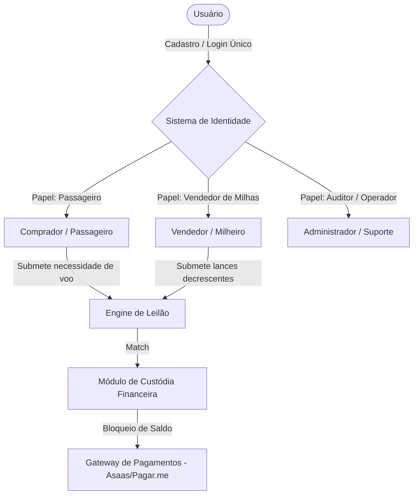
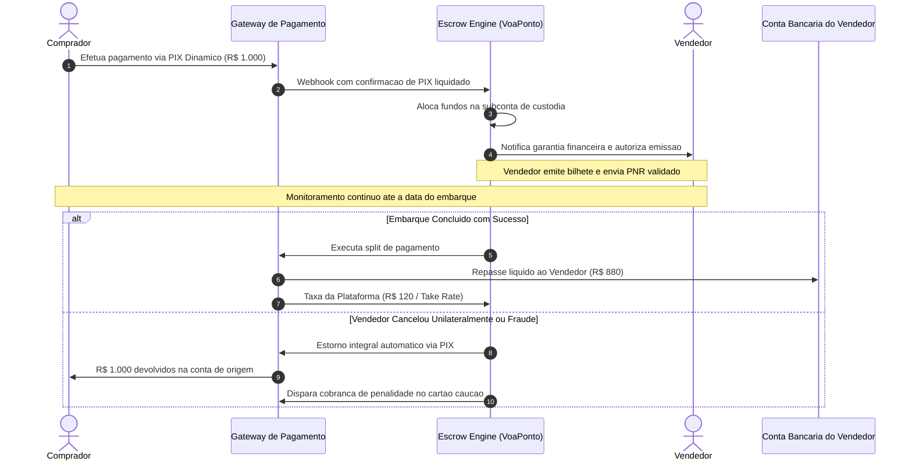
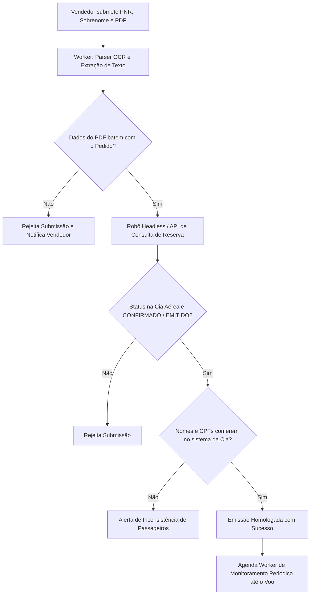

# Documentação Técnica e Especificação Integral: VoaPonto (Plataforma de Leilão Reverso e Intermediação Segura de Passagens com Milhas)

---

## 1. Visão Geral do Negócio, Proposta de Valor e Modelo Econômico

### 1.1 Contexto e Problema de Mercado
O mercado de cartões de crédito e fidelidade no Brasil movimenta centenas de bilhões de pontos anualmente através de programas bancários (Livelo do Bradesco/Banco do Brasil, Esfera do Santander, C6 Átomos, Itaú IUPP) e programas aéreos (Smiles da GOL, LATAM Pass da LATAM, Azul Fidelidade da Azul).
Contudo, milhões de consumidores e famílias não viajam com frequência suficiente para utilizar seus saldos antes da expiração. Quando decidem resgatar esses pontos dentro dos catálogos próprios dos programas (para comprar eletrodomésticos, eletrônicos ou vales-compra), sofrem uma perda média de 50% a 70% do valor econômico real do ponto.

Por outro lado, o consumidor final (passageiro) enfrenta tarifas aéreas elevadas nos balcões oficiais das companhias aéreas, especialmente em passagens compradas com datas próximas, alta temporada ou feriados.

### 1.2 A Solução VoaPonto
A plataforma **VoaPonto** opera como um **Marketplace Bilateral com Leilão Reverso e Custódia Financeira (Escrow)**:
- **Para o Vendedor (Milheiro):** Monetização direta de milhas emitindo passagens para terceiros, definindo seu próprio preço via disputa de lances e recebendo via PIX com liquidação transparente.
- **Para o Comprador (Passageiro):** Descontos de 15% a 40% em relação ao balcão oficial da companhia aérea, com garantia irrevogável de embarque ou estorno integral imediato via PIX caso ocorra qualquer problema.
- **Para a Plataforma (Monetização / Take Rate):** Retenção de uma taxa de intermediação de **8% a 15%** calculada sobre o valor transacionado, deduzida no momento do repasse final ao vendedor.

---

## 2. Atores do Sistema e Perfis de Acesso



### 2.1 Comprador (Passageiro)
- Busca rotas aéreas (Origem, Destino, Data de Ida, Data de Volta opcional, Classe de Voo, Bagagem despachada).
- Define o **Preço Teto (Lance Máximo)** que aceita pagar pela passagem.
- Efetua o pagamento via PIX Dinâmico (QR Code) garantindo os fundos na custódia da plataforma.
- Recebe o código localizador (PNR de 6 caracteres), e-ticket (13 dígitos) e arquivo PDF original do bilhete emitido.
- Acompanha o status do voo em tempo real até o desembarque.

### 2.2 Vendedor (Detentor de Milhas / Milheiro)
- Cadastra suas contas de programas de fidelidade ativas (Smiles, LATAM Pass, Azul Fidelidade) e informa a quantidade de pontos disponível e sua **cota restante de CPFs para o ciclo anual**.
- Cadastra obrigatoriamente um **Cartão de Crédito de Garantia** com limite ativo ou mantém **Saldo Caução** em carteira interna.
- Recebe notificações push instantâneas no celular quando surgem ordens de compra compatíveis com seu saldo.
- Envia lances decrescentes no leilão reverso para vencer a disputa.
- Emite a passagem aérea no aplicativo/site oficial da companhia aérea utilizando seus pontos assim que o pagamento do comprador for confirmado na custódia.
- Submete o código PNR, sobrenome do passageiro principal e PDF da emissão na plataforma para verificação.

### 2.3 Administrador / Auditor
- Acompanha painéis analíticos de liquidação financeira, volume transacionado (GMV) e receita líquida.
- Gerencia a fila de exceções e alertas automáticos de descompasso de PNR (cancelamentos detectados pelos robôs de monitoramento).
- Modera disputas e autoriza execuções de garantia/caução em casos comprovados de fraude.

---

## 3. Dinâmica Completa do Leilão Reverso e Ciclo de Vida do Pedido

### 3.1 Estados da Ordem de Compra (`AuctionStatus`)

```
   ┌────────────────────────────────────────────────────────┐
   │                       CRIADO                           │
   │        (Comprador define rota e lance teto)            │
   └────────────────────────────────────────────────────────┘
                               │
                               ▼
   ┌────────────────────────────────────────────────────────┐
   │                    EM DISPUTA                          │
   │    (Vendedores enviam lances menores; timer de 30-120m)│
   └────────────────────────────────────────────────────────┘
                               │
                               ▼
   ┌────────────────────────────────────────────────────────┐
   │                     MATCH                              │
   │     (Menor lance selecionado; Comprador notificado)    │
   └────────────────────────────────────────────────────────┘
                               │
                               ▼
   ┌────────────────────────────────────────────────────────┐
   │               AGUARDANDO PAGAMENTO                     │
   │      (Comprador tem 15 minutos para pagar o PIX)       │
   └────────────────────────────────────────────────────────┘
                 │                            │
      (Não pagou no prazo)            (PIX Confirmado)
                 ▼                            ▼
   ┌───────────────────────┐   ┌────────────────────────────┐
   │      EXPIRADO         │   │   PAGO / AGUARDANDO EMISSÃO│
   │ (Ordem cancelada)     │   │ (Dados liberados ao Vendedor;│
   └───────────────────────┘   │  timer de 2 horas para PNR)│
                               └────────────────────────────┘
                                             │
                   ┌─────────────────────────┴────────────────────────┐
         (Vendedor não emitiu)                              (Vendedor enviou PNR)
                   ▼                                                  ▼
   ┌───────────────────────────────┐                  ┌───────────────────────────────┐
   │       ESTORNADO 100%          │                  │       EM VERIFICAÇÃO          │
   │ (PIX devolvido imediatamente; │                  │ (Robô e parser validam dados) │
   │ vendedor multado / bloqueado) │                  └───────────────────────────────┘
   └───────────────────────────────┘                                  │
                                                    ┌─────────────────┴─────────────────┐
                                          (Dados inconsistentes)             (PNR Validado com Sucesso)
                                                    ▼                                   ▼
                                      ┌───────────────────────────┐       ┌───────────────────────────┐
                                      │        REJEITADO          │       │      EMITIDO / SEGURO     │
                                      │ (Vendedor notificado para │       │(Passageiro recebe bilhete;│
                                      │  correção em 30 minutos)  │       │ robô monitora até o voo)  │
                                      └───────────────────────────┘       └───────────────────────────┘
                                                                                        │
                                                                                        ▼
                                                                          ┌───────────────────────────┐
                                                                          │        CONCLUÍDO          │
                                                                          │  (Voo realizado / D+1;    │
                                                                          │   repasse liquidado ao    │
                                                                          │        vendedor)          │
                                                                          └───────────────────────────┘
```

### 3.2 O Algoritmo de Match e Anti-Sniper
1. **Duração da Janela de Leilão:** Configurável de 15 minutos a 2 horas (para voos urgentes de última hora, janela expressa de 10 minutos).
2. **Regra de Incremento Mínimo:** Cada novo lance deve ser pelo menos R$ 10,00 ou 1% inferior ao lance líder atual para evitar micro-lances insignificantes.
3. **Mecanismo Anti-Sniper:** Se um lance for registrado nos últimos 60 segundos do cronômetro, o prazo do leilão é estendido automaticamente em mais 2 minutos, garantindo disputa justa e evitando trapaças de automação de milissegundos.
4. **Reserva Imediata ("Compre Já"):** O comprador pode opcionalmente definir um valor de compra imediata. Se um vendedor aceitar emitir exatamente por aquele valor, o leilão é encerrado instantaneamente sem necessidade de aguardar o término do cronômetro.

---

## 4. O Sistema de Custódia Financeira (Escrow Engine)



### 4.1 Retenção em Conta Segura
O montante pago pelo passageiro jamais transita pela conta bancária do vendedor nem se mistura ao caixa operacional da empresa. Ele é custodiado em uma **subconta gráfica de garantia** integrada diretamente ao gateway de pagamento (instituição autorizada pelo Banco Central do Brasil).

### 4.2 Modelo de Liberação Escalonada por Reputação (*Seller Trust Tier*)
Para não desestimular vendedores experientes e ao mesmo tempo blindar compradores contra golpistas, a liberação financeira opera em 3 níveis:

| Nível do Vendedor | Requisitos de Entrada | Política de Liberação Financeira | Exigência de Garantia |
| :--- | :--- | :--- | :--- |
| **Bronze (Iniciante)** | 0 a 5 emissões concluídas com sucesso | **100% retido até D+1 do embarque** do passageiro | Cartão de crédito de garantia obrigatório |
| **Prata (Consolidado)** | 6 a 30 emissões, 0 cancelamentos, nota > 4.8 | **30% liberado na validação do PNR** + 70% retido até D+1 do embarque | Cartão de garantia ou caução de R$ 500 |
| **Ouro (Profissional)** | +30 emissões, KYC biométrico aprovado | **70% liberado na validação do PNR** + 30% pós-embarque | Linha de crédito pré-aprovada na plataforma |

---

### 4.3 Política de Retenção da Taxa da Plataforma (*Take Rate*): Quem Paga e Configuração

#### A. Quem Paga a Taxa?
No modelo de leilão reverso, a melhor prática de mercado (usada por plataformas como Uber, Airbnb e Mercado Livre) é:
- **O Comprador paga o valor final do match:** O valor do lance vencedor é o valor total que o passageiro paga (sem taxas ocultas no checkout que gerem atrito de conversão).
- **A Taxa é deduzida do repasse do Vendedor:** A taxa de serviço da plataforma é retida no momento do split financeiro.
- **Transparência no Painel do Vendedor:** Ao dar um lance de, por exemplo, R$ 1.000,00, a interface do vendedor já exibe em tempo real:
  - *Lance Ofertado:* R$ 1.000,00
  - *Taxa VoaPonto (10%):* -R$ 100,00
  - *Líquido a Receber na sua Conta:* **R$ 900,00**

#### B. Qual a Taxa Recomendada?
- **Fase de Lançamento / Aquisição de Mercado (MVP):** **8% a 10%** (taxa atrativa para atrair milheiros e garantir preços muito agressivos para compradores).
- **Fase de Operação Consolidada:** **10% a 14%** (margem saudável para cobrir custos de infraestrutura, gateway de pagamentos, validações biométricas e atendimento ao cliente, mantendo lucro consistente).
- *Comparativo de Mercado:* Antigas agências e intermediadoras compravam milhas pagando R$ 14 a R$ 18 por milheiro e revendiam por R$ 28 a R$ 35 (uma margem de mais de 50%). No VoaPonto, uma taxa de 10% a 12% é extremamente vantajosa para ambos os lados.

#### C. Parametrização e Configuração Dinâmica da Taxa
A taxa não é fixa no código-fonte (*hardcoded*), mas sim configurável dinamicamente via painel administrativo (`PlatformConfig`), permitindo:
1. **Taxa Padrão Global:** Percentual base aplicado a todos os leilões (ex: 10%).
2. **Taxa Diferenciada por Programa Fidelidade:** Permite definir taxas menores para companhias mais restritivas (ex: 8% para Azul devido ao limite menor de CPFs).
3. **Bonificação de Fidelidade / Volume:** Vendedores Ouro ou de alto volume podem receber desconto na taxa (ex: 8%), incentivando permanência na plataforma.
4. **Piso Mínimo por Transação:** Taxa mínima fixa (ex: R$ 30,00) para garantir rentabilidade em passagens de valor muito baixo.

---

## 5. Regras de Negócio, Aspectos Regulatórios e Jurídicos

### 5.1 Regulação de Milhas no Brasil e Termos das Companhias Aéreas
- **Legalidade da Titularidade:** A jurisprudência majoritária no Brasil (com base no Código de Defesa do Consumidor e precedentes do STJ) reconhece que os pontos e milhas acumulados constituem patrimônio do consumidor, fruto de sua contraprestação onerosa (uso do cartão ou compra de passagens).
- **Termos de Uso das Cias Aéreas:** Em contrapartida, as companhias aéreas proíbem a intermediação e venda de milhas em seus regulamentos de fidelidade, punindo contas suspeitas com cancelamentos ou bloqueio de programas.
- **A Abordagem VoaPonto:** A plataforma **não compra milhas em atacado** (diferente de modelos quebrados como o da 123milhas). O vendedor atua emitindo individualmente para o passageiro em sua própria conta de fidelidade. O contrato jurídico assinado é de **intermediação de serviços de emissão de bilhete aéreo**.

### 5.2 Limites de CPFs Anuais por Programa e Matriz de Reuso
Cada companhia aérea limita o número de passageiros distintos que uma mesma conta de fidelidade pode emitir no ciclo de 12 meses:

| Companhia / Programa | Limite de CPFs Distintos | Período de Apuração | Regra para o Titular | Regra de Reuso do Mesmo Passageiro |
| :--- | :--- | :--- | :--- | :--- |
| **Smiles (GOL)** | 25 CPFs distintos | Ano civil (1 de jan a 31 de dez) | Não consome vaga | **Ilimitado.** O passageiro já inserido pode emitir infinitas vezes no mesmo ano sem gastar novas vagas. |
| **LATAM Pass** | 24 CPFs distintos | 12 meses móveis (contados da emissão) | Não consome vaga | **Ilimitado.** Reemissões para o mesmo CPF no período de 12 meses não consomem cotas adicionais. |
| **Azul Fidelidade** | 5 CPFs cadastrados | Lista fixa prévia | Não consome vaga | Requer cadastro prévio com **60 dias de carência** para novas alterações. |

#### O Algoritmo de Afinidade de CPF (*CPF Loyalty Matching*)
No momento em que um comprador publica um pedido de voo:
1. O backend verifica se o CPF daquele passageiro já consta na base histórica de emissões de algum vendedor ativo.
2. Caso positivo, o lance desse vendedor recebe um selo de **"Vendedor com Afinidade de CPF"** e prioridade no desempate de lances iguais, pois para aquele vendedor o custo de oportunidade da vaga é zero.

### 5.3 Blindagem e Responsabilização contra Cancelamento Unilateral de Má-Fé
Se um vendedor agir de má-fé, aguardar a liberação do dinheiro e depois cancelar a passagem no site da companhia aérea para reaver as milhas:
1. **Instrumento Particular com Força de Título Executivo Extrajudicial:** No aceite da emissão, ambas as partes assinam digitalmente (com hash SHA-256 e carimbo de tempo) um contrato que estipula confissão irretratável de dívida.
2. **Cobrança Imediata do Cartão de Garantia:** A plataforma executa o débito da penalidade (100% do valor da passagem + taxa de reacomodação emergencial) no cartão de crédito cadastrado do vendedor.
3. **Notificação Extrajudicial e Processo Criminal:** Envio de notificação eletrônica imediata e encaminhamento dos logs auditados e do documento assinado para a autoridade policial competente para investigação de estelionato (Art. 171 do Código Penal) e execução civil direta via protesto em cartório.

---

## 6. Arquitetura de Validação da Emissão (Verificação do Bilhete)

Como a plataforma atesta com 100% de certeza que o vendedor gerou o bilhete correto antes de qualquer movimentação?



1. **Camada 1: Parsing e Extração de Dados do PDF:**
   - O vendedor faz upload do bilhete emitido (PDF oficial da Smiles, LATAM ou Azul).
   - O worker de OCR (`pdf-parse` / Tesseract) extrai:
     - Código Localizador (PNR de 6 dígitos alfanuméricos).
     - Número do Bilhete Eletrônico (*e-Ticket* de 13 dígitos).
     - Trecho exato (Códigos IATA dos aeroportos: ex: GRU ⇄ REC).
     - Datas, horários e números de voos.
     - Nomes completos e documentos dos passageiros.
2. **Camada 2: Consulta Automatizada de Integridade (Robô Headless / Web Scraper):**
   - Utilizando instâncias controladas de Puppeteer/Playwright rodando em ambiente isolado, o sistema acessa os portais de consulta pública das companhias:
     - Smiles: `voegol.com.br/minhas-viagens`
     - LATAM: `latamairlines.com/br/pt/minhas-viagens`
     - Azul: `voeazul.com.br/br/pt/minhas-viagens`
   - O robô autentica a consulta utilizando o PNR + Último Sobrenome do passageiro principal.
   - Valida o status do bilhete: deve retornar obrigatoriamente `CONFIRMADO` ou `EMITIDO / TICKETED`.
3. **Camada 3: Monitoramento Contínuo até o Embarque (PNR Poller):**
   - O sistema agenda verificações periódicas no Redis BullMQ:
     - Intervalo semanal para voos com mais de 30 dias de antecedência.
     - Intervalo diário nos últimos 7 dias antes do voo.
     - Intervalo de 2 horas nas últimas 48 horas que antecedem a decolagem.
   - Qualquer alteração não autorizada para o status `CANCELADO` dispara alerta nível vermelho na central de operações.

---

## 7. Plataformas Suportadas: Desktop e Mobile Nativo

### 7.1 Aplicativo Mobile Nativo (React Native / Expo)
O aplicativo móvel é o centro operacional para vendedores e passageiros:
- **Para Vendedores:**
  - Notificações Push sonoras e prioritárias a cada lance concorrente ou pedido com match.
  - Acesso à câmera nativa para documentoscopia e reconhecimento facial no cadastro.
  - Integração com a bandeja de compartilhamento do sistema operacional (Android / iOS): o vendedor baixa o PDF da passagem no app da companhia aérea e clica em "Compartilhar com VoaPonto", enviando o comprovante diretamente para validação.
  - Autenticação biométrica local (Touch ID / Face ID) para confirmação de lances e ordens.
- **Para Compradores:**
  - Notificação de confirmação de pagamento instantânea.
  - Armazenamento offline do bilhete e cartão de embarque na carteira do app.
  - Botão de consulta rápida que abre diretamente o aplicativo oficial da companhia aérea já preenchido com o localizador.

### 7.2 Aplicação Web Responsiva (Next.js)
- Focada na captação orgânica (SEO) de compradores pesquisando passagens baratas no Google.
- Painel analítico avançado para vendedores com histórico financeiro, extratos de retenção, controle de quotas de CPFs por companhia e relatórios para declaração de imposto de renda.
- Dashboard administrativo com ferramentas completas de conciliação financeira, monitoramento de filas e atendimento a disputas.

---

## 8. Arquitetura de Software e Stack Tecnológica Detalhada

```
┌────────────────────────────────────────────────────────────────────────┐
│                        CLIENT LAYER (INTERFACES)                       │
│   Web App: Next.js (React 19, App Router, Tailwind CSS, Shadcn UI)     │
│   Mobile App: React Native (Expo SDK 51+, TypeScript, NativeWind)       │
└──────────────────────────────────┬─────────────────────────────────────┘
                                   │ HTTPS / REST / WebSockets
                                   ▼
┌────────────────────────────────────────────────────────────────────────┐
│                       GATEWAY & REVERSE PROXY                          │
│   Cloudflare (CDN, WAF, Proteção DDoS, SSL Edge)                       │
│   Nginx / Traefik (Roteamento de tráfego e rate limiting)             │
└──────────────────────────────────┬─────────────────────────────────────┘
                                   │
                                   ▼
┌────────────────────────────────────────────────────────────────────────┐
│                     BACKEND (MONOLITO MODULAR)                         │
│   Framework: NestJS (Node.js 20 LTS com TypeScript estrito)            │
│   Módulos de Domínio:                                                  │
│   ├── auth/          (Autenticação, JWT, RBAC, KYC)                    │
│   ├── auctions/      (Leilão reverso, lances, matching, timers)        │
│   ├── escrow/        (Custódia financeira, split, webhooks do gateway) │
│   ├── tickets/       (Submissão de PNR, OCR de PDF, validação)         │
│   ├── sellers/       (Controle de limites de CPFs, contas fidelidade)  │
│   └── notifications/ (Push notifications, alertas WhatsApp, E-mails)   │
└──────────────┬───────────────────┬───────────────────┬─────────────────┘
               │                   │                   │
               ▼                   ▼                   ▼
┌──────────────────────┐  ┌──────────────────┐  ┌───────────────────────┐
│   BANCO DE DADOS     │  │   FILAS & CACHE  │  │  WORKERS DE SCRAPING  │
│  PostgreSQL 16       │  │  Redis 7         │  │  Node.js + Playwright │
│  (ACID, Prisma ORM,  │  │  (BullMQ para    │  │  (Headless Chrome em  │
│   Auditoria Estrita) │  │   timers e jobs) │  │   containers Docker)  │
└──────────────────────┘  └──────────────────┘  └───────────────────────┘
```

---

## 9. Estimativa Detalhada de Custos de Infraestrutura e Ferramentas

### 9.1 Fase Inicial (MVP / Homologação e Primeiro Ano)

| Categoria | Provedor / Ferramenta | Especificação Técnica | Custo Mensal Estimado |
| :--- | :--- | :--- | :--- |
| **Servidores Backend** | Railway ou Render | 1 Container API (2 vCPU, 4GB RAM) + 1 Container Worker | \$15 a \$30 (~R\$ 80 - R\$ 170) |
| **Banco de Dados** | Supabase ou Neon DB | Instância PostgreSQL dedicada com backups diários | \$0 a \$25 (Free Tier ou ~R\$ 140) |
| **Fila e Cache** | Upstash Redis | Redis serverless com persistência e conexão TLS | \$0 (Free Tier cobre até 10.000 comandos/dia) |
| **Gateway de Pagamento** | Asaas | Conta PJ com suporte nativo a PIX dinâmico e split | R\$ 0 fixo (R\$ 1,89 por PIX recebido / 0,99%) |
| **Push Notifications** | Expo Application Services | Serviço oficial de notificações push para iOS e Android | \$0 / Gratuito ilimitado |
| **Alertas WhatsApp** | Evolution API (Self-hosted) | Instância Docker da Evolution API conectada ao WhatsApp | R\$ 35 / mês (hospedada em VPS básica) |
| **Domínio e DNS** | Registro.br + Cloudflare | Domínio `.com.br` com proteção anti-DDoS e CDN | R\$ 40 / ano (~R\$ 3,33 / mês) |
| **Lojas Mobile** | Apple Developer + Google Play | Publicação dos apps nativos | • Google Play: \$25 taxa única<br>• Apple: \$99 / ano (~R\$ 550) |

> **Custo Operacional Mensal do MVP:** **R\$ 150 a R\$ 400 por mês** (mais os custos de publicação anual das lojas de aplicativos).

### 9.2 Fase de Escala (5.000 a 20.000 transações/mês)
- Servidores em cluster gerenciado (AWS ECS ou Hetzner Dedicated): \$150 a \$350 / mês.
- PostgreSQL Gerenciado em Alta Disponibilidade (AWS RDS com Read Replica): \$120 a \$250 / mês.
- Provedor de KYC e Biometria Facial Automatizada (CAF ou Unico): R\$ 2,20 por vendedor verificado.
- Margem de segurança de infraestrutura totalmente coberta com menos de 1% do GMV gerado pela plataforma.

---

## 10. Estratégia de Go-To-Market (Divulgação) e Confiança Radical

### 10.1 Aquisição Estruturada da Oferta (Vendedores)
1. **Comunidades Fechadas de Investimento e Milhas:** Abordagem direta em grupos de networking no Telegram, WhatsApp e fóruns de cartões de crédito. A proposta de valor é clara: *"Receba em tempo real emitindo passagens para pessoas reais, sem ficar meses na mão de intermediadoras em recuperação judicial"*.
2. **Parcerias com Educadores Financeiros e Produtores de Conteúdo:** Afiliados que ensinam a acumular milhas com cartões de crédito recomendam o VoaPonto como a ferramenta oficial para monetizar os pontos de seus alunos.

### 10.2 Aquisição Estruturada da Demanda (Passageiros)
1. **Anúncios de Comparação de Preço em Tempo Real (Meta Ads & Google Search):** Campanhas exibindo casos reais de passagens caras no balcão que saem muito mais baratas no leilão de milhas garantido.
2. **SEO Programático:** Criação automatizada de landing pages indexáveis para todas as rotas populares do país (ex: `VoaPonto.com.br/passagens/sao-paulo-para-recife`).

### 10.3 Pilares de Confiança Radical (*Trust & Safety*)
- **Selo de Proteção de Custódia:** Comunicação visual ostensiva no checkout informando que o dinheiro permanece sob custódia protegida de instituição autorizada pelo Banco Central.
- **Garantia de Estorno Imediato via PIX:** Em caso de não emissão no prazo pelo vendedor, o estorno de 100% é processado de forma automática e imediata pelo sistema, sem necessidade de abertura de chamados ou atendimento humano.
- **Validação Cruzada no Portal Oficial:** Logo após o recebimento do localizador, o passageiro é orientado passo a passo a abrir o aplicativo oficial da companhia aérea e comprovar por conta própria que a reserva já se encontra confirmada em seu nome.
